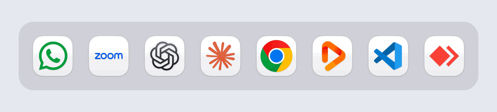
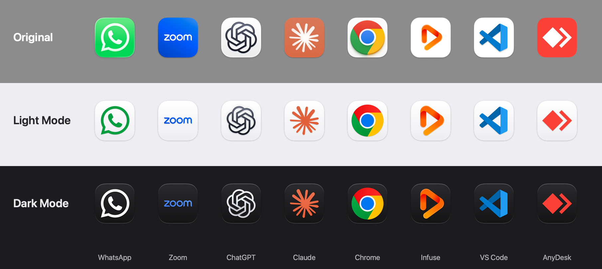

# &nbsp;&nbsp;Iconos

*Un estilo de icono limpio y uniforme para todas las apps de tu Mac, en modo claro y oscuro*

    [](https://github.com/asubervirojas/iconos/releases/latest)

**Iconos** extrae solo el logo del icono de cada app, quita la placa de fondo del fabricante y lo pone sobre una ficha al estilo de macOS: blanca en modo claro y oscura en modo oscuro. Un pequeño agente en segundo plano cambia cada icono cuando cambias la apariencia y lo vuelve a poner si la app se actualiza.

[Read in English](README.md)

---

<p align="center">
  
</p>

---

## 📥 Cómo descargar Iconos

1. **GitHub Releases:** [descarga la última versión](https://github.com/asubervirojas/iconos/releases/latest) (`Iconos-x.y.z.zip`).
2. **Compilar desde el código:** mira [Compilar desde el código](#-compilar-desde-el-código).

> [!NOTE]
> Iconos es gratis y no está notarizada por Apple (no hay cuenta de pago de Apple Developer). La primera vez que la abras, macOS la bloquea: ve a **Ajustes del Sistema → Privacidad y seguridad**, pulsa **Abrir igualmente** junto al mensaje de Iconos y confirma **Abrir**. Solo se hace una vez.

---

## 🔍 Por qué existe Iconos

macOS 26 unificó el aspecto del Dock, pero cada app sigue trayendo su propia placa: cuadros verdes, azules, blancos, degradados. Algunas se adaptan al modo oscuro y la mayoría no. Iconos hace que todas sigan un mismo estilo y una misma apariencia, sin tocar nada dentro de las apps.

---

## ✅ Funciones principales

- **Solo el logo:** quita la placa de fondo del fabricante y conserva el logo, con sus colores adaptados a cada ficha.
- **Logos exactos en iconos de Icon Composer:** en las apps hechas con Icon Composer de Apple (la mayoría de las nuevas), Iconos lee las capas originales: el logo sale perfecto y con la variante oscura del propio fabricante.
- **Cambio automático claro/oscuro:** un agente ligero cambia cada icono cuando el Mac cambia de apariencia, también con el horario automático.
- **Sobrevive a las actualizaciones:** si una app se actualiza y pierde el icono, el agente lo vuelve a poner. Si el fabricante cambia su logo, Iconos lo regenera, o te pide revisarlo si el resultado nuevo no es fiable.
- **Nivel de confianza:** cada extracción se califica como *fiable*, *revísalo* o *no salió bien*, con el motivo. ¿Prefieres el icono completo? Un clic. ¿Tienes tu propio diseño? Usa tus imágenes clara y oscura.
- **Varias apps a la vez:** aplica, restaura o cambia varias apps juntas. Filtra por estado (personalizadas, sin permiso, no se pueden cambiar…).
- **Seguro:** guarda una copia del icono personalizado que la app tuviera antes, nunca escribe dentro de `Contents` y **Desinstalar** lo devuelve todo.
- **Privado:** no se conecta a internet ni recoge datos. Todo queda en `~/Library/Application Support/Iconos`.

---

## 🖼 Antes y después

<p align="center">
  <a href="docs/readme-assets/comparacion.png">
    
  </a>
</p>

<p align="center"><sub>Resultado real de Iconos 1.0.0. Los nombres, iconos y logos pertenecen a sus dueños.</sub></p>

---

## ⚡ Inicio rápido

1. Descarga y descomprime la última versión, mueve **Iconos.app** a **Aplicaciones** y ábrela (mira la nota de **Abrir igualmente**).
2. Sigue la **guía de primeros pasos**: comprueba cada permiso y te da un botón para cada uno.
3. Elige una app en la barra lateral, mira las vistas previas clara y oscura y pulsa **Aplicar** (**⌘S**).
4. Activa el **cambio automático** para que el agente siga el modo claro y oscuro.

> [!IMPORTANT]
> Activa **Gestión de apps** para **Iconos** e **Iconos Agente** en **Ajustes del Sistema → Privacidad y seguridad → Gestión de apps**. macOS protege las apps de cambios, e Iconos escribe el archivo estándar de icono personalizado (`Icon\r`, el mismo que usa Finder) dentro de cada app.

| Permiso | Para qué |
|---|---|
| **Gestión de apps** (Iconos e Iconos Agente) | Escribir el icono en cada app y cambiarlo con la apariencia. |
| **Notificaciones** (opcional) | Avisarte si una actualización quitó un permiso o el fabricante cambió su logo. |
| **Tu contraseña, en Terminal** (solo algunas apps) | Mira abajo. |

### Apps instaladas con `.pkg` o desde la App Store

Estas apps pertenecen al sistema (root): ni con Gestión de apps alcanza. Para ellas, Iconos primero **te muestra el comando exacto** y luego abre **Terminal** para que **tú** escribas la contraseña. Iconos nunca la ve.

El comando añade una regla de acceso solo en la carpeta principal de esa app, para que tu usuario pueda crear el archivo del icono:

```bash
sudo chmod +a "<tu usuario> allow add_file,writeattr,writeextattr" /Applications/App.app
```

> [!NOTE]
> No toca nada dentro de la app (`Contents`) y se puede revertir: **Restaurar** en Iconos ofrece quitarla, o ejecuta `sudo chmod -a "<tu usuario> allow add_file,writeattr,writeextattr" /Applications/App.app`. Puedes verla con `ls -led /Applications/App.app`. Para este paso Terminal también necesita Gestión de apps.

Las apps del volumen del sistema (como Safari) o bloqueadas por su fabricante no se pueden cambiar; Iconos las marca con un candado gris.

---

## 🧩 Cómo funciona

- **Capas de Icon Composer:** Iconos lee el icono por capas de la app con el framework CoreUI de Apple y dibuja las capas del logo sin el fondo, para la apariencia clara y la oscura.
- **Extractor de píxeles:** en los iconos clásicos detecta la placa de fondo (cuadrada, redondeada, circular, con marco…), separa el logo y califica la confianza del resultado.
- **La fuente de mayor resolución:** usa siempre el icono más grande que trae la app (hasta 1024 px).
- **Archivo de icono personalizado:** el resultado se escribe como icono personalizado de la app (`Icon\r` y la marca de Finder), igual que al pegar un icono en **Obtener información**.

> [!WARNING]
> Para leer las capas de Icon Composer usa el framework **privado** CoreUI de Apple. Si una versión futura de macOS lo cambia, Iconos usa automáticamente el extractor de píxeles. Probado en macOS 26 y 27.

---

## ⚙️ Requisitos

- **Sistema:** macOS 26 (Tahoe) o posterior.
- **Arquitectura:** Apple Silicon (M1 o posterior).
- **Permisos:** Gestión de apps para Iconos e Iconos Agente.

---

## 🌍 Idiomas

- 🇺🇸 Inglés (en)
- 🇪🇸 Español (es)

La app sigue el idioma del Mac. Se aceptan traducciones por pull request (`Recursos/Localizable.xcstrings`).

---

## 🗑 Desinstalar

Abre **Iconos → Ajustes → Desinstalar Iconos…**. Restaura el icono original de cada app, apaga el agente, quita las reglas de acceso que añadió (pidiendo tu contraseña una vez si hay alguna), borra sus datos y se mueve a la Papelera. Si alguna app no se puede restaurar, no se borra nada para que puedas reintentarlo.

---

## 🛠 Compilar desde el código

Necesita **Xcode 26** o posterior (Xcode completo, no solo las Command Line Tools, porque el icono se compila con `actool`).

```bash
git clone https://github.com/asubervirojas/iconos.git
cd iconos
./compilar.sh --crear-firma   # una vez: crea una identidad de firma local autofirmada en tu llavero
./compilar.sh --instalar      # compila, firma e instala en ~/Applications
```

> [!TIP]
> macOS recuerda Gestión de apps por la firma de la app. Firma siempre con la misma identidad (`ICONOS_FIRMA` fija su nombre); si no, macOS volverá a pedir el permiso tras cada compilación. `./compilar.sh --release` genera el zip y su SHA-256.

---

## ❓ Preguntas frecuentes

**¿Modifica las apps?** Solo su icono personalizado, el mismo archivo que escribe Finder al pegar un icono en Obtener información. No toca el código, la firma ni `Contents`.

**¿Qué pasa cuando una app se actualiza?** La mayoría de las actualizaciones conservan el icono. Si alguna lo quita, el agente lo vuelve a poner en menos de un minuto. Si la actualización reemplazó una app de root, Iconos te avisa para volver a darle permiso.

**¿Por qué no está en la App Store ni notarizada?** La App Store no permite apps que modifican otras apps, y la notarización necesita una cuenta de pago de Apple Developer. Iconos es gratis y de código abierto: puedes leer cada línea y compilarla tú mismo.

**¿Necesita internet?** No. No hace ninguna conexión de red.

---

## 🙏 Créditos

Hecho por **Armando Subervi** con ayuda de IA: Claude (Anthropic) y Codex (OpenAI).

Los nombres, iconos y logos que aparecen pertenecen a sus dueños. Iconos no está afiliado ni respaldado por ninguno de ellos, ni por Apple.

---

## 📄 Licencia

[MIT](LICENSE)
