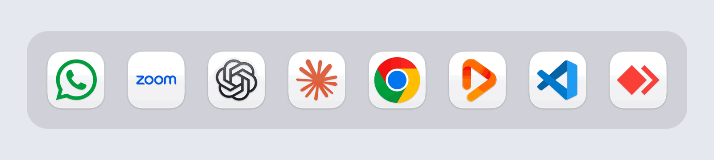
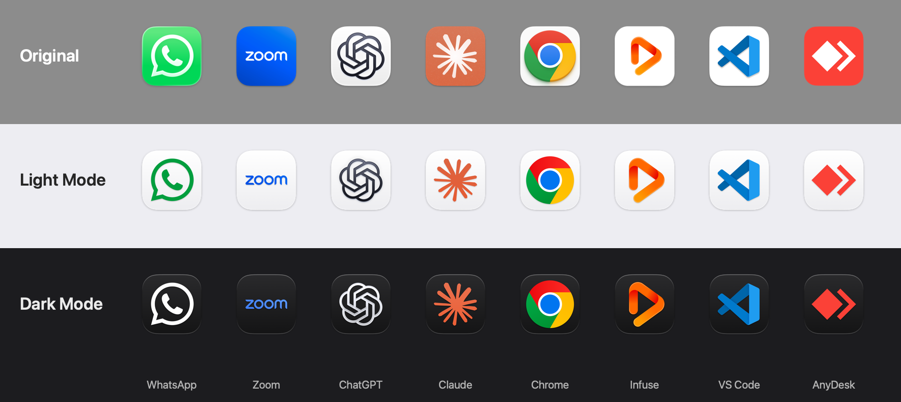

# &nbsp;&nbsp;Iconos

*One clean, consistent icon style for every app on your Mac, in Light and Dark Mode*

    [](https://github.com/asubervirojas/iconos/releases/latest)

**Iconos** extracts just the logo from each app's icon, drops the vendor's background plate, and places it on a native macOS-style tile: white in Light Mode, dark in Dark Mode. A small background agent switches every icon when you change appearance and puts it back after an app updates itself.

[Leer en español](README.es.md)

---

<p align="center">
  
</p>

---

## 📥 How to Download Iconos

1. **GitHub Releases:** [Download the latest release](https://github.com/asubervirojas/iconos/releases/latest) (`Iconos-x.y.z.zip`).
2. **Build from source:** see [Build from Source](#-build-from-source).

> [!NOTE]
> Iconos is free and not notarized by Apple (no paid Apple Developer account). The first time you open it, macOS blocks it: go to **System Settings → Privacy & Security**, click **Open Anyway** next to the Iconos message, then confirm **Open**. You only do this once.

---

## 🔍 Why Iconos Exists

macOS 26 gave the Dock a unified look, but every app still ships its own plate: green squares, blue squares, white squares, gradients. Some apps adapt to Dark Mode, most don't. Iconos makes them all follow one style and one appearance, without touching what's inside the apps.

---

## ✅ Key Features

- **Logo-only extraction:** removes the vendor's background plate and keeps the logo, with its own colors adapted to each tile.
- **Exact logos for Icon Composer icons:** for apps built with Apple's Icon Composer (most new apps), Iconos reads the original layers, so the logo is pixel-perfect and uses the vendor's own dark variant.
- **Automatic Light/Dark switching:** a lightweight agent swaps every icon when your Mac changes appearance, including the automatic sunset/sunrise schedule.
- **Survives updates:** when an app updates and loses its custom icon, the agent puts it back. If the vendor changes its logo, Iconos regenerates it, or asks you to review it if the new result looks unreliable.
- **Confidence score:** every extraction is rated *reliable*, *check it* or *didn't work*, with the reason. Prefer the full icon? One click. Have your own artwork? Use your own light and dark images.
- **Batch actions:** apply, restore or change several apps at once. Filter by status (customized, needs permission, can't be changed…).
- **Safe by design:** keeps a backup of any custom icon the app already had, never writes inside the app's `Contents`, and **Uninstall** restores everything.
- **Private:** never connects to the internet, no analytics. Everything stays in `~/Library/Application Support/Iconos`.

---

## 🖼 Before and After

<p align="center">
  <a href="docs/readme-assets/comparacion.png">
    
  </a>
</p>

<p align="center"><sub>Real output of Iconos 1.0.0. App names, icons and logos belong to their respective owners.</sub></p>

---

## ⚡ Quick Start

1. Download and unzip the latest release, move **Iconos.app** to **Applications** and open it (see the note above about **Open Anyway**).
2. Follow the built-in **setup guide**: it checks each permission and gives you a button for every step.
3. Pick an app in the sidebar, check the light and dark previews, and press **Apply** (**⌘S**).
4. Turn on the **automatic switch** so the agent follows Light and Dark Mode.

> [!IMPORTANT]
> Enable **App Management** for both **Iconos** and **Iconos Agente** in **System Settings → Privacy & Security → App Management**. macOS protects apps from being modified, and Iconos writes the standard custom-icon file (`Icon\r`, the same one Finder uses) into each app.

| Permission | Why it's needed |
|---|---|
| **App Management** (Iconos and Iconos Agente) | Write the custom icon into each app and switch it with your appearance. |
| **Notifications** (optional) | Tell you when an update removed a permission or a vendor changed its logo. |
| **Your password, in Terminal** (only some apps) | See below. |

### Apps installed with a `.pkg` or from the App Store

These apps are owned by the system (root), so even App Management isn't enough. For them, Iconos first **shows you the exact command**, then opens **Terminal** so **you** type your password there. Iconos never sees it.

The command adds one access rule to that app's top folder only, so your user can add the icon file:

```bash
sudo chmod +a "<you> allow add_file,writeattr,writeextattr" /Applications/App.app
```

> [!NOTE]
> Nothing inside the app (`Contents`) is touched, and it's fully reversible: **Restore** in Iconos offers to remove it, or run `sudo chmod -a "<you> allow add_file,writeattr,writeextattr" /Applications/App.app`. Check it any time with `ls -led /Applications/App.app`. Terminal itself needs App Management for this step.

Apps on the read-only system volume (like Safari) or locked by their vendor can't be changed. Iconos marks them with a gray lock.

---

## 🧩 How It Works

- **Icon Composer layers:** Iconos reads the app's layered icon through Apple's CoreUI framework and renders the logo layers without the background, for both the light and the dark appearance.
- **Pixel extractor:** for classic icons, it detects the background plate (square, rounded, circular, framed…) and separates the logo from it, then rates how confident the result is.
- **Highest-resolution source:** it always uses the largest icon the app ships (up to 1024 px).
- **Custom icon file:** the result is written as the app's custom icon (`Icon\r` plus the Finder flag), exactly like pasting an icon in **Get Info**.

> [!WARNING]
> Reading Icon Composer layers uses Apple's **private** CoreUI framework. If a future macOS changes it, Iconos falls back to the pixel extractor automatically. Tested on macOS 26 and 27.

---

## ⚙️ Requirements

- **System:** macOS 26 (Tahoe) or later.
- **Architecture:** Apple Silicon (M1 or newer).
- **Permissions:** App Management for Iconos and Iconos Agente.

---

## 🌍 Available Languages

- 🇺🇸 English (en)
- 🇪🇸 Spanish (es)

The app follows your Mac's language. Translations are welcome via pull request (`Recursos/Localizable.xcstrings`).

---

## 🗑 Uninstall

Open **Iconos → Settings → Uninstall Iconos…**. It restores every app's original icon, turns off the agent, removes the Terminal access rules it added (asking for your password once if there are any), deletes its data and moves itself to the Trash. If any app can't be restored, nothing is deleted so you can retry.

---

## 🛠 Build from Source

Requires **Xcode 26** or later (the full Xcode, not only the Command Line Tools, because the app icon is compiled with `actool`).

```bash
git clone https://github.com/asubervirojas/iconos.git
cd iconos
./compilar.sh --crear-firma   # once: creates a local self-signed code-signing identity in your keychain
./compilar.sh --instalar      # builds, signs and installs to ~/Applications
```

> [!TIP]
> macOS remembers App Management by the app's signature. Always sign with the same identity (`ICONOS_FIRMA` sets its name) or macOS will ask for the permission again after each build. `./compilar.sh --release` builds the zip and its SHA-256.

---

## ❓ FAQ

**Does it modify the apps?** Only their custom icon, the same file Finder writes when you paste an icon in Get Info. App code, signatures and `Contents` are not touched. The only exception is the optional Dock fix for Electron apps (below), which changes the running app in memory and never its files.

**What happens when an app updates?** Most updates keep the custom icon. If one removes it, the agent puts it back within a minute. If an update replaced a root-owned app, Iconos notifies you to allow it again.

**Why does an app show its own icon in the Dock while it's open?** Some apps replace their Dock icon from their own code while running: apps built with egui/eframe do it every time they open, and others (Zoom, Teams, some Electron apps) do it to show an alert or a theme. For those, the custom icon still shows in Finder, Spotlight and in the Dock while the app is closed. A few apps ship a Dock tile plug-in that draws the Dock icon even while closed; Finder and Spotlight still show the custom icon. macOS doesn't let another app stop this without modifying the app, so Iconos tells you when it detects one. For some Electron apps there is an optional fix, see the next question.

**Can Iconos keep its icon in the Dock for an Electron app that changes it?** Yes, for Electron apps whose vendor left the inspector enabled (for example Antigravity), as an option you turn on per app ("Keep the Iconos icon in the Dock", next to the Dock notice; needs the automatic switching agent). Each time the app opens, the agent sends it SIGUSR1, which makes Electron open its Node inspector on 127.0.0.1:9229. It checks that the process answering is that app, replaces `app.dock.setIcon` with an empty function and asks the Dock for the bundle icon, then closes the inspector. Nothing is written to the app, its signature and updates are untouched, and the change disappears when you quit it. Trade-offs: for under a second a debugging port is open on your Mac's loopback interface, the vendor's icon can show for the first couple of seconds after opening, and turning the option off takes effect the next time the app opens. It does nothing for apps that aren't Electron, use Electron older than 34, or whose vendor turned the inspector off.

**Why isn't it on the App Store or notarized?** The App Store doesn't allow apps that modify other apps, and notarization needs a paid Apple Developer account. Iconos is free and open source; you can read every line and build it yourself.

**Does it need internet?** No. It never connects to the internet. The only network traffic is a local connection to 127.0.0.1, and only if you turn on "Keep the Iconos icon in the Dock" for an Electron app.

---

## 🙏 Credits

Built by **Armando Subervi** with AI assistance from Claude (Anthropic) and Codex (OpenAI).

App names, icons and logos shown belong to their respective owners. Iconos is not affiliated with or endorsed by any of them, or by Apple.

---

## 📄 License

[MIT](LICENSE)
